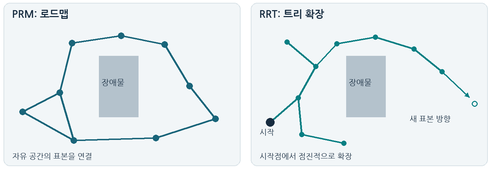
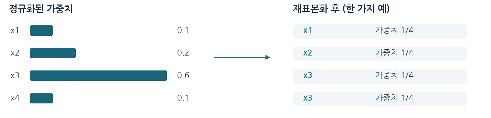
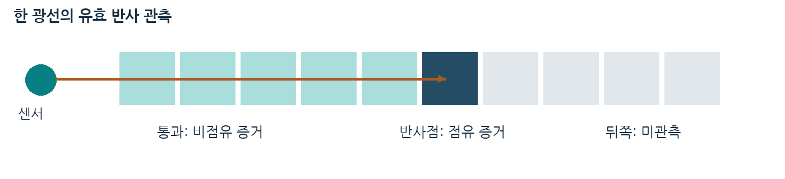

# GPS와 필터를 이용한 캠퍼스 위치 추정

1주차 보고서 | 2026년도 가을학기 로봇 알고리즘 (SWE4007)

**16번 개인 · 2021245017 공지혁 · GitHub: kjhmoon**

## 1. 환경 세팅 및 Git 실습

1주차에는 개발 환경과 제출 폴더를 구성하고, 자기소개 작성, GitHub 업로드, 새 폴더에서의 clone 및 실행 확인을 진행하였다. 배경지식은 수업에서 학습한 PRM과 RRT를 포함하여 정리하였다.

### 1.1 개발 환경

| 항목 | 확인 결과 |
| --- | --- |
| 운영체제 | Microsoft Windows 11 Home |
| Git | 2.55.0.windows.3 |
| Python | 3.13.15 - 요구 조건인 3.10 이상 충족 |
| Arduino IDE | 2.3.10 - 설치 목록과 실행 파일 버전으로 확인 |
| Python 추가 패키지 | 환경 확인 코드에는 필요하지 않음 |

Arduino IDE는 공식 배포 ZIP의 해시 검증 후 사용자 영역에 설치하였다. 보드 연결, 스케치 컴파일 및 업로드는 이번 기록의 검증 범위에 포함하지 않았다.

### 1.2 저장소 구성과 업로드 확인

저장소 이름은 **RobotAlgorithm-GPS-Localization-team16**이며, 개인 계정 **kjhmoon**으로 관리한다. 개인 진행이므로 별도 팀원 초대 대상은 없다. 루트의 team.md에 이름, 학번, GitHub ID와 번호를 기록하였다.

1. 루트에 src, week1부터 week4까지의 디렉터리를 구성하였다. 각 주차에 README.md, src, reports/figures를 두었다.
2. 2021245017_공지혁.md에 81자의 자기소개를 작성하였다. 300자 이내 조건을 충족한다.
3. main 브랜치에서 파일을 커밋하고 origin에 push하였다. 초기 커밋은 **27b94b5**이며, 작성자 정보는 공지혁과 GitHub 비공개 이메일 주소를 사용하였다.
4. GitHub 웹페이지에서 폴더와 자기소개 파일을 확인하였다. 별도의 새 폴더에 clone한 뒤 아래 두 명령이 모두 정상 종료되는 것을 확인하였다.

```text
python src/check_environment.py
python week1/src/check_environment.py
Python: 3.13.15
Python >= 3.10: PASS
Week 1 structure: PASS
```

코드는 pathlib 상대경로를 사용하며, week1/src에 코드 복사본을 두었다. 환경 확인 코드에는 필터 하이퍼파라미터가 없다. GPS 수집 및 필터 성능 실험은 수행하지 않았다.

<!-- pagebreak -->

## 2.1 경로 계획에서 샘플링이 필요한 이유

로봇의 자세를 나타내는 구성 공간은 보통 연속적이다. 따라서 가능한 모든 자세와 경로를 열거하기 어렵다. 자유도가 d이고 각 축을 n개로 나누면 격자 수는 n^d로 증가한다. 예를 들어 6차원 공간의 각 축을 100개로 나누면 10^12개의 격자가 필요하다. 이는 차원 증가에 따른 계산량 문제를 보여주는 단순 계산 예시이다.

샘플링 기반 경로 계획은 구성 공간에서 일부 자세를 선택하고, 선택한 자세와 연결 경로에 대해 충돌을 검사한다. 장애물에 해당하는 구성 공간 전체를 명시적으로 계산하는 대신, 충돌 검사기를 통해 자유 공간을 탐색하는 방식이다. 복잡한 형상이나 높은 자유도를 가진 로봇에서 계산을 현실적인 범위로 줄일 수 있다. 다만 모든 경로 계획 문제에서 샘플링이 필수인 것은 아니며, 저차원 격자 환경에서는 격자 탐색도 사용할 수 있다. [1]

### 수업에서 학습한 방법: PRM과 RRT

| 방법 | 구성 과정과 특징 |
| --- | --- |
| PRM | 자유 공간의 표본을 정점으로 만들고, 주변 정점 사이의 충돌 없는 경로를 간선으로 연결한다. 시작점과 목표점을 이 로드맵에 연결한 뒤 그래프를 탐색한다. 같은 환경에서 여러 경로 질의를 처리할 때 로드맵을 재사용할 수 있다. [2] |
| RRT | 시작점에서 트리를 만들고, 무작위 표본 쪽으로 가까운 노드에서 확장한다. 확장 경로의 충돌을 확인하며 탐색 영역을 넓힌다. 일반적으로 하나의 시작점과 목표점 사이의 탐색에 활용한다. [3] |



좁은 통로에 표본이 충분히 생성되지 않으면 경로를 찾기 어려울 수 있다. 표준 PRM과 RRT는 적절한 가정 아래 표본 수가 증가할수록 해를 찾을 확률이 높아지는 확률적 완전성을 논의할 수 있지만, 유한한 표본에서 항상 성공하는 것은 아니다. 또한 기본 알고리즘이 자동으로 최단 경로를 보장하지는 않는다. [1, 2, 3]

<!-- pagebreak -->

## 2.2 칼만 필터(KF)란 무엇이며 언제 필요한가

칼만 필터는 잡음이 있는 관측과 시스템의 운동 모델을 결합하여 시간에 따라 변하는 상태를 추정하는 재귀적 방법이다. 이전 추정으로 현재 상태를 예측한 뒤, 새 관측을 이용해 예측을 보정한다. 모든 과거 관측을 매번 다시 계산하지 않고 상태의 평균과 공분산을 갱신한다. [4]

### 모델과 갱신 과정

기본 KF는 상태와 관측이 선형 관계이고, 초기 상태와 잡음이 가우시안 분포를 따른다고 가정할 때 정확한 사후분포를 계산한다. 아래에서는 과정 잡음과 관측 잡음이 서로 독립이고 평균이 0이라고 둔다. [4]

```text
State model:       x_t = F x_(t-1) + B u_t + w_t
Measurement:       z_t = H x_t + v_t
Noise covariance:  Cov(w_t) = Q,  Cov(v_t) = R

Predict:
  x_pred = F x_prev + B u_t
  P_pred = F P_prev F^T + Q

Update:
  S      = H P_pred H^T + R
  K      = P_pred H^T S^(-1)
  x_post = x_pred + K (z_t - H x_pred)
  P_post = P_pred - K S K^T
```

x는 상태, z는 관측, F는 상태 전이 행렬, H는 관측 행렬이다. P는 상태 추정 오차의 공분산이며, K는 칼만 이득이다. Q와 R은 각각 운동 모델과 센서 측정의 불확실성을 나타낸다. [4]

### 필요한 상황과 캠퍼스 위치 추정에의 적용

GPS 관측에는 흔들림이 있고, 운동 모델만 사용하면 실제 움직임과 차이가 누적될 수 있다. 이때 두 정보를 불확실성에 따라 결합하여 위치와 속도를 함께 추정할 수 있다. 예를 들어 상태를 동쪽·북쪽 위치와 속도로 구성하고, GPS 위치를 관측으로 사용할 수 있다. 위도·경도는 지역 기준점에 대한 미터 좌표로 변환하여 단위를 맞추는 설계를 고려할 수 있다. 이는 향후 적용 구상이며 실측 결과는 아니다.

### 단순 수치 예시

1차원 위치에서 예측값이 10 m, 예측 분산이 4 m^2이고, 관측이 13 m, 관측 잡음 분산이 9 m^2라고 하자. H=1이면 K=4/(4+9)=4/13이고, 보정값은 10+(4/13)*3로 약 **10.92 m**이다. 관측이 더 불확실하므로 예측 쪽에 가까운 결과가 나온다. 이 수치는 이해를 위한 계산 예시이다.

GPS의 큰 이상치나 강한 비선형성까지 기본 KF가 자동으로 해결하는 것은 아니다. 비선형 모델에는 EKF·UKF 등의 근사 방법을 고려하고, 실제 데이터에 맞는 잡음 모델도 검토해야 한다. [4]

<!-- pagebreak -->

## 2.3 파티클 필터란 무엇이며 언제 필요한가

파티클 필터는 가능한 상태를 나타내는 표본인 파티클과 각 파티클의 가중치로 사후분포를 근사한다. 하나의 평균과 공분산에 제한되지 않아 여러 위치 후보가 동시에 존재하는 분포나 비선형·비가우시안 모델을 다룰 수 있다. 초기 위치를 모르는 로봇의 전역 위치 추정에 활용할 수 있다. [5, 7]

일반적인 절차는 **초기화 → 운동에 따른 표본 생성 → 관측에 따른 가중치 계산·정규화 → 필요 시 재표본화**이다. 표본 수가 부족하면 실제 위치 주변의 가설을 놓칠 수 있고, 표본 수를 늘리면 계산량이 증가한다. 재표본화를 지나치게 반복하면 파티클 다양성이 줄어들 수 있다. [5, 6]



위 그림의 선택 결과는 가능한 한 가지 예시이며, 가중치가 큰 표본만 확정적으로 남기는 연산을 뜻하지 않는다. 재표본화는 확률적으로 수행한다.

## 2.4 Importance sampling과 파티클 필터

과제 안내의 “Important sample”은 문맥상 **importance sampling(중요도 샘플링)**으로 해석하였다. 목표분포에서 직접 표본을 뽑기 어려울 때, 표본을 생성하기 쉬운 제안분포 q에서 뽑고 목표분포와의 비율을 가중치로 보정하는 방법이다. 목표분포가 양수인 영역에서 q도 양수여야 한다. [6]

```text
Importance weight:  weight_i is proportional to pi(x_i) / q(x_i)

Sequential particle weight:
  a_i = p(z_t | x_t_i) * p(x_t_i | x_prev_i, u_t)
  b_i = q(x_t_i | x_prev_i, u_t, z_t)
  w_t_i is proportional to w_prev_i * a_i / b_i

Normalize:  W_i = w_i / sum_j(w_j)
ESS:        N_eff = 1 / sum_i(W_i^2)
```

pi는 목표분포, q는 제안분포, p(z_t | x_t_i)는 관측 우도이다. 파티클 필터에서는 매 시점의 복잡한 사후분포에서 직접 표본을 얻기 어렵기 때문에 이 원리로 관측 정보를 반영한다. 제안분포로 운동 전이분포를 사용하면 전이분포 항이 약분되어, 가중치는 이전 가중치와 관측 우도의 곱에 비례한다. [5, 6]

중요도 샘플링과 재표본화는 다른 단계이다. 전자는 표본의 가중치를 보정하고, 후자는 정규화된 가중치에 따라 다시 표본을 선택한다. N_eff가 작아지면 소수 표본에 가중치가 집중된 상태이므로 재표본화를 고려한다. 이 과정이 표본 부족이나 잘못된 제안분포를 모두 해결해 주지는 않는다. [6]

<!-- pagebreak -->

## 2.5 Localization 문제를 푸는 이유와 현실의 대응 문제

Localization은 센서와 이동 정보를 이용하여 기준 좌표계에서 현재 위치 또는 자세를 추정하는 문제이다. 평면 이동 로봇의 자세는 보통 위치와 방향인 (x, y, theta)로 표현한다. 현재 위치를 알아야 경로의 출발점을 정하고, 목표와의 차이를 계산하며, 지도와 센서 관측을 연결할 수 있다. 초기 위치를 아는 추적 문제와 초기 위치를 모르는 전역 위치 추정을 구분할 수 있다. [7]

현실의 대응 사례로는 캠퍼스 지도에서 보행자의 위치 표시, 배송 로봇의 경로 추종, 창고 로봇의 통로 내 위치 파악이 있다. 이는 개념에 대응시킨 적용 예시이다. 본 프로젝트에서는 GPS 관측으로 캠퍼스 내 위치를 추정하고, 이후 필터를 적용하여 관측 잡음과 운동의 불확실성을 다루는 문제로 연결할 수 있다. 한 시점의 GPS 위치만으로 로봇의 방향까지 모두 관측되는 것은 아니다.

지도 자체도 함께 추정하면 SLAM 문제로 확장된다. 이번 설명의 Localization은 지도 또는 기준 좌표계가 주어졌을 때 자신의 위치를 구하는 문제에 초점을 둔다.

## 2.6 Occupancy grid map과 센서 기반 생성 방법

Occupancy grid map은 공간을 일정 크기의 셀로 나누고, 각 셀에 장애물이 존재할 확률을 저장하는 지도이다. 초기 점유확률을 0.5로 두면 점유 여부에 대한 사전 정보가 없는 상태를 나타낼 수 있다. 셀을 독립적으로 갱신하는 방식은 계산을 줄이기 위한 근사이다. [8]

1. 지도 해상도와 범위를 정하고 셀의 점유확률을 초기화한다.
2. 로봇과 센서의 자세를 이용해 거리·방향 관측을 지도 좌표계에 연결한다.
3. 유효한 반사점이 있다면 광선이 지나간 구간은 비점유 증거, 반사점 주변은 점유 증거로 반영한다. 반사점 뒤쪽은 관측되지 않았으므로 그대로 둔다.
4. 여러 시점의 관측을 베이즈 갱신으로 누적한다. 최대 거리까지 반사가 없을 때는 끝점에 장애물이 있다고 단정하지 않고 센서 모델에 따라 처리한다. [8]



작은 셀은 세부 형상을 표현하기 좋지만 메모리와 계산량이 증가한다. 센서 잡음과 로봇 자세 오차도 지도 품질에 영향을 주므로 반복 측정과 적절한 센서 모델이 필요하다. GPS 위치만으로 장애물 점유 지도를 만들 수는 없으며, 거리나 장애물 관측 정보가 추가로 필요하다. [8]

<!-- pagebreak -->

## 3. 참고문헌 및 확인 자료

아래 자료를 참고하여 개념을 정리하였다. 그림 1부터 3까지는 설명을 위해 직접 작성하였으며, 실제 캠퍼스 지도나 수집 데이터의 실험 결과가 아니다.

### 경로 계획

[1] Steven M. LaValle, Planning Algorithms, Chapter 5: Sampling-Based Motion Planning, Cambridge University Press, 2006. 샘플링 철학과 완전성에 대한 설명.

https://msl.cs.uiuc.edu/planning/node181.html

[2] 같은 책, Section 5.6.1: The Basic Method. PRM의 전처리 및 경로 질의 단계.

https://msl.cs.uiuc.edu/planning/node240.html

[3] 같은 책, Section 5.5.1: The Exploration Algorithm. RRT 계열 트리 탐색과 충돌 검사.

https://msl.cs.uiuc.edu/planning/node231.html

### 상태 추정과 지도

[4] Simo Sarkka, Bayesian Filtering and Smoothing, Cambridge University Press, 2013, Section 3.5 및 Chapter 4. 선형 가우시안 상태공간 모델과 KF 갱신식.

https://users.aalto.fi/~ssarkka/pub/cup_book_online_20131111.pdf

[5] M. S. Arulampalam, S. Maskell, N. Gordon, T. Clapp, “A Tutorial on Particle Filters for Online Nonlinear/Non-Gaussian Bayesian Tracking,” IEEE Transactions on Signal Processing, 50(2), 174-188, 2002. DOI: 10.1109/78.978374.

https://doi.org/10.1109/78.978374

[6] Arnaud Doucet, Adam M. Johansen, “A Tutorial on Particle Filtering and Smoothing: Fifteen Years Later,” The Oxford Handbook of Nonlinear Filtering, 2011, Sections 3.2-3.5.

https://www.stats.ox.ac.uk/~doucet/doucet_johansen_tutorialPF2011.pdf

[7] D. Fox, W. Burgard, F. Dellaert, S. Thrun, “Monte Carlo Localization: Efficient Position Estimation for Mobile Robots,” AAAI, 1999.

https://www.cs.cmu.edu/~thrun/papers/fox.aaai99.pdf

[8] Alberto Elfes, “Occupancy Grids: A Stochastic Spatial Representation for Active Robot Perception,” arXiv:1304.1098, 2013 아카이브본, Sections 2.1-2.3.

https://arxiv.org/abs/1304.1098

### 프로젝트 확인 자료

저장소와 커밋 내역: https://github.com/kjhmoon/RobotAlgorithm-GPS-Localization-team16

환경 확인 코드와 실행법: src/check_environment.py, week1/src/check_environment.py, week1/README.md. 코드·파일 구조 검사와 Git clone 확인은 실제 실행 결과이며, 필터의 위치 정확도 평가를 뜻하지 않는다.
